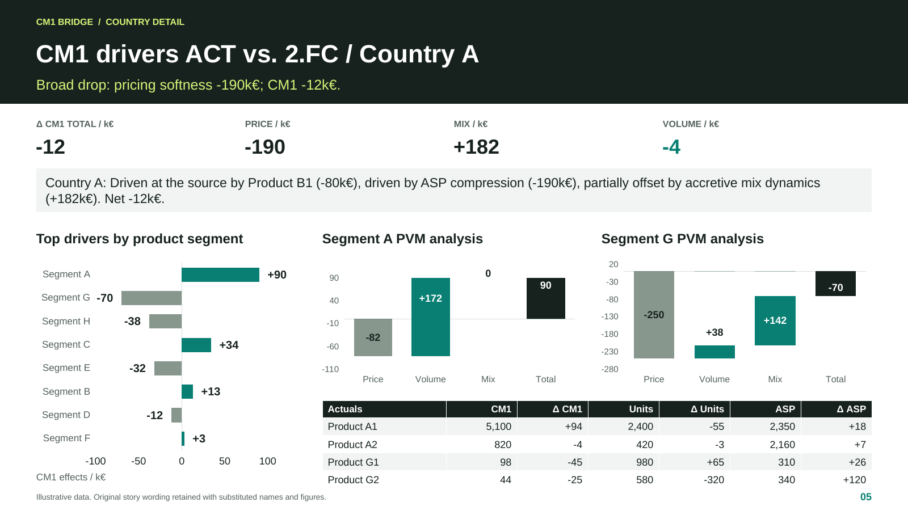

# Profitability Driver Analysis: Price, Volume and Mix

**Explain the movement behind a margin result, so management knows where to investigate.**

Actuals-versus-expectation totals can conceal large, opposing movements across countries and product segments. Finance needs to identify the material contributions before asking sales teams for a commercial explanation.

**My contribution:** I developed the recurring analysis and reporting workflow, evolving Excel and Power Query work into Python-based calculations, hierarchy-aware driver selection and reporting feeds. I defined when to drill down, which offsets to retain and how to trace each statement to its inputs.

**Result and status:** repeatable analysis and a first draft of management commentary. This repository provides the public commentary engine and a runnable fictional example. It consumes prepared effects; it does not reproduce the full calculation pipeline or establish commercial causes. The scope and interpretation of the residual labelled “mix” are explained below.

[Read the business case](https://matthew-bangle-data-portfolio.mattbangle.chatgpt.site/work/profitability-driver-analysis) · [Run the public example](#run-the-public-example)

## A small net change can hide the real story

In the fictional demo, Country B is only **€20,000 ahead**. Underneath, Segment C improves by **€400,000** while Segment D declines by **€380,000**. Reporting only the country total would conceal both movements.

The engine identifies the opposing effects and their hierarchy paths. Management can then investigate why those segments differ, compare countries and challenge its understanding of market trends. The output supplies an analytical starting point; it does not invent commercial causes.

## My contribution and analytical choices

I developed the wider workflow from Power Query and Excel into Python-based calculations, hierarchy-aware driver selection and reporting feeds. Excel outputs fed linked PowerPoint text and charts. This repository exposes the **commentary engine**, its rules and a runnable fictional example.

The recurring challenge was choosing the right explanatory detail: when to drill into a product group, when a segment was sufficient and when a net result obscured important offsets.

| Reporting need | Design decision | Value to finance and management |
| --- | --- | --- |
| Understand actuals versus expectations | Separate price, volume and residual effects | Make the contribution to the margin movement visible |
| Find the right explanatory detail | Apply materiality and concentration rules through the hierarchy | Explain a product, segment or country only when supported |
| See pressures hidden by net totals | Identify material gains and declines separately | Keep offsetting problems visible |
| Prepare recurring management packs | Generate a consistent first draft and reporting feed | Spend review time on commercial context and follow-up |
| Challenge a statement | Retain selected paths, amounts and rule settings | Trace the commentary back to the evidence |

## What the workflow enabled

Repeatable preparation and first-draft commentary gave finance more time for commercial interpretation and follow-up. An earlier historical estimate was about 2.5 hours of preparation reduced to around 30 seconds of processing after source refresh. That estimate excludes refresh and review and is not a benchmark of this public demo.

**Interpretation matters:** the public engine consumes already calculated effects. In the reviewed wider workflow, “mix” is a residual that can include cost or reconciliation effects. It cannot independently establish a shift toward less profitable products. Finance still determines the business explanation.

“CM1” is the original internal contribution-margin label, retained in the repository and code names. The public title describes the business question.

## Run the public example

Python · Excel / Power Query · management reporting

[](LICENSE)
[](https://github.com/mattbang/cm1-insight-engine/actions/workflows/tests.yml)

Python 3.11 or 3.12, as configured in the public test workflow:

```sh
python -m venv .venv
source .venv/bin/activate  # Windows: .venv\Scripts\activate
python -m pip install -r requirements-dev.txt
python demo.py
python -m pytest
```

The demo generates commentary, a CSV reporting feed and an evidence record from fictional countries and products. The [Excel exhibit](examples/generated/reporting-feed.xlsx) illustrates the reporting-cell layout; it is packaged separately and is not regenerated by the demo.

## Inspect the implementation

[Read generated commentary](examples/generated/management-commentary.md) · [Five-slide showcase](assets/CM1_Insight_Engine_Showcase.pdf)



*Fictional data. This earlier reporting showcase illustrates the presentation approach; the linked generated commentary shows the current public engine's output.*

[Selection logic](docs/logic.md) · [Engine](src/cm1_narratives.py) · [Inputs and outputs](docs/demo.md) · [Validation scope](docs/validation.md) · [One-page handout](assets/CM1_Insight_Engine_Handout.pdf)

Source ingestion, the full production calculation pipeline and live PowerPoint connections are outside this package. Current public code, historical experience and retained showcase assets have different scopes. All public example data is synthetic.

[Matthew Bangle](https://www.linkedin.com/in/matthew-bangle/) · [Full portfolio](https://matthew-bangle-data-portfolio.mattbangle.chatgpt.site/work) · [MIT License](LICENSE)
