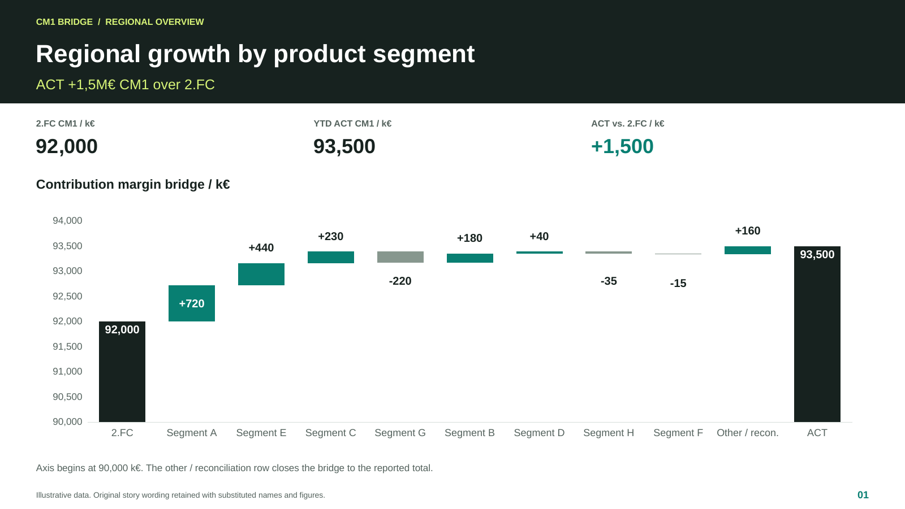
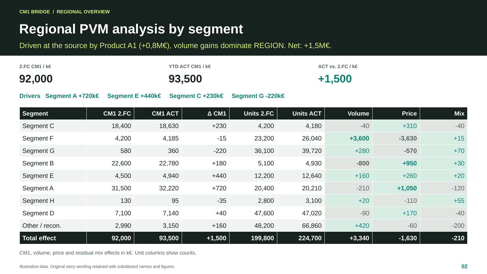
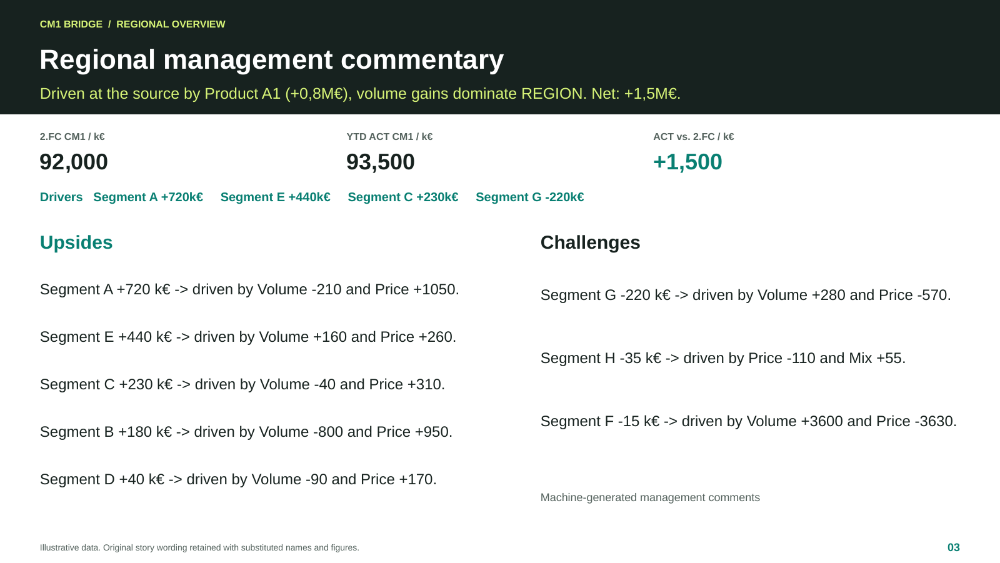
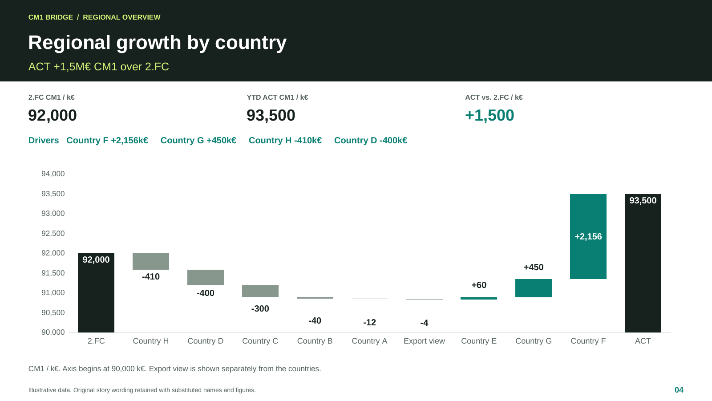

# Reporting showcase

Five slides show how the reporting workflow connects regional performance, country comparisons and product drivers with executive commentary. The first four are regional views. The fifth brings the analysis together for one country.

[Download the editable PowerPoint](../assets/CM1_Insight_Engine_Showcase.pptx) · [Read the slide PDF](../assets/CM1_Insight_Engine_Showcase.pdf) · [One-page project handout](../assets/CM1_Insight_Engine_Handout.pdf)

| Slide | What it demonstrates |
| --- | --- |
| 1. Regional growth by product segment | A margin bridge shows which segments explain the change from forecast to actual. |
| 2. Regional PVM analysis by segment | Price, volume and residual mix effects make the main movements and offsets visible. |
| 3. Regional management commentary | Generated comments turn the calculated movements into a first draft of the executive summary. |
| 4. Regional growth by country | A common view compares countries without rebuilding each analysis separately. |
| 5. Country detail | A country story sits alongside segment rankings, focused PVM bridges and supporting product metrics. |

In the operational workflow, formatted Excel output supplied the text, charts and supporting tables for linked PowerPoint reporting through Empower. Updating the workbook allowed the presentation to refresh without manually rewriting each text box or rebuilding its charts. This public deck is a standalone illustration: its text, charts and tables are editable, and its embedded workbooks contain only the synthetic chart data. It has no live Excel or Empower links.

All entities and business figures are fictional. The slide comments preserve the wording of an earlier machine-generated output, with names and figures substituted. They illustrate the reporting format and development history, rather than a fresh run of the current narrative logic. Later improvements to driver attribution and neutral residual-mix language are described elsewhere in this repository. The [showcase data](../assets/showcase-data.json) records the illustrative figures and retained story strings.

The handout's processing times are historical project estimates, not an independently measured benchmark. They exclude source refresh and downstream report refresh and review.

## 1. Regional growth by product segment

## 2. Regional PVM analysis by segment

## 3. Regional management commentary

## 4. Regional growth by country

## 5. Country detail

